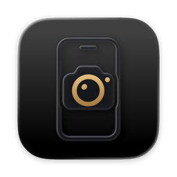
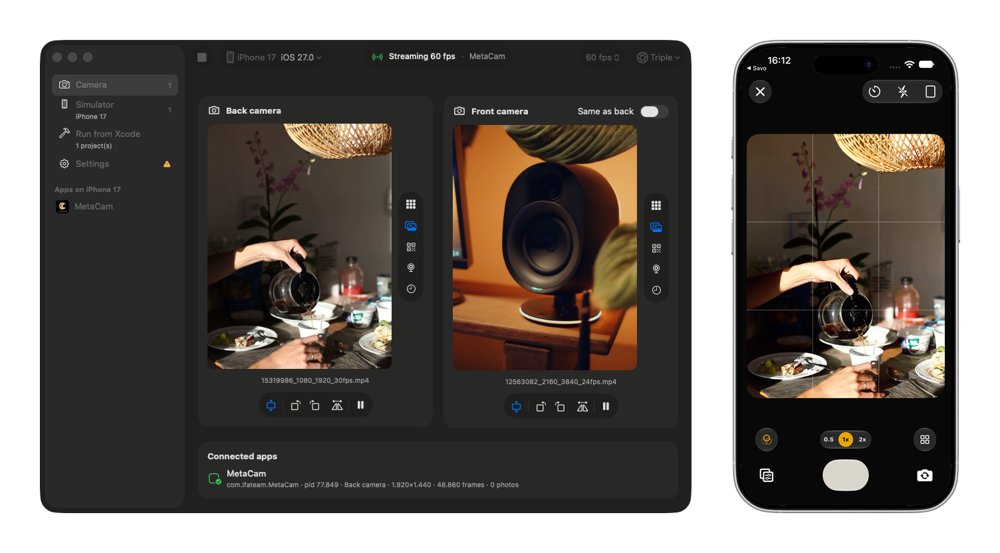
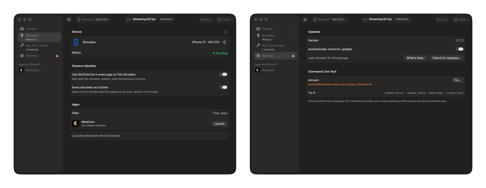

<div align="center">
  
  <h1>SimCam Lite</h1>
  <p><em>A free, open-source camera for the iOS Simulator.</em></p>
</div>

<p align="center">
  
  
  <a href="LICENSE"></a>
</p>

<p align="center">
  
</p>

The iOS Simulator has no camera. If your app takes photos, scans QR codes or shows a live preview, you normally have to
run it on a real iPhone every time you touch that code.

SimCam Lite gives the Simulator a working camera. Pick a photo, a video, a QR code or your Mac's camera, and every app
on the Simulator sees it as the iPhone's back or front camera. **You don't change a single line of your app's code.**

## Why SimCam Lite?

I built it because nothing I tried fit my day-to-day work:

- The polished simulator camera tools are commercial and need a paid license, often per seat.
- The open-source projects I found were abandoned, needed code changes or a special SDK inside the app, or only
  supported a still image.

SimCam Lite is free and MIT licensed. It works with apps you launch from the Simulator and apps you run from Xcode with
the debugger attached.

## Features

- **Any source as the camera**: a photo, a looping video, a QR code generated from a link or text, your Mac's camera,
  or a test pattern. Drag and drop a file onto the preview to switch.
- **Separate back and front cameras**: give each its own source, or let the front camera follow the back one.
- **Works with your existing code**: camera preview, video frames, photo capture and device rotation behave the way
  your app expects on a real device.
- **Realistic devices**: emulate triple (0.5× · 1× · 3×), dual wide or single cameras, at 30 or 60 fps.
- **Fit, rotate and mirror** each source, and pause videos on a frame.
- **Simulator manager**: see every simulator, boot one, and launch any installed app with the camera turned on.
- **Run from Xcode**: set up a project once and keep using Xcode's Run button and debugger.
- **Command-line tool**: control everything from Terminal, scripts or CI with `simcam`.
- **Menu bar app**: keeps streaming in the background, with quick access to sources and simulators.
- **Automatic updates** with release notes, so you always know what changed.

<p align="center">
  
</p>

## Install

### Download the app

1. Download `SimCamLite-<version>.dmg` from the [latest release](https://github.com/huyhunhngc/SimCamLite/releases/latest).
2. Open the DMG and drag **SimCam Lite** to Applications.
3. Open it. The app is signed and notarized by Apple, and it updates itself from then on.

### Build from source

You need Xcode 26 or newer and [XcodeGen](https://github.com/yonaskolb/XcodeGen).

```bash
brew install xcodegen
```

```bash
git clone https://github.com/huyhunhngc/SimCamLite.git
```

```bash
cd SimCamLite && scripts/build.sh
```

The app is written to `build/SimCamLite.app`. Before the first build, copy `Config/Environment.example.xcconfig` to
`Config/Environment.xcconfig` and set `SIMCAM_DEVELOPMENT_TEAM` to your Apple Developer team ID. Release builds are
signed with a Developer ID certificate; if you don't have one, run `scripts/build.sh Debug` instead.

### Homebrew

Coming soon.

## Getting started

1. Open SimCam Lite and choose a source for the back camera: **Pattern**, **File…**, **QR…** or **Mac camera**.
2. Go to **Simulator**, pick a simulator and turn on **Use SimCamLite in every app on this simulator**.
3. Open any app on the Simulator. Its camera now shows your source.

Running your app from Xcode? Open **Run from Xcode** and choose **Set Up Project…** once per project, then press Run as
usual. See [How injection works](docs/injection.md) for the details.

## Command line

Install the `simcam` tool from **Settings › Command Line Tool**. It controls the running app, so the window and Terminal
always agree, and it opens SimCam Lite in the background when needed.

| Command | What it does |
| --- | --- |
| `simcam start` / `stop` / `quit` | Start or stop streaming, or quit the app |
| `simcam status` | Show the sources and the apps using the camera |
| `simcam source ~/Pictures/receipt.jpg` | Use a photo or video as the back camera |
| `simcam source --front camera` | Use your Mac's camera as the front camera |
| `simcam source qr "https://example.com"` | Show a QR code for a link or text |
| `simcam source pattern` | Show the test pattern |
| `simcam adjust --fit --rotate 90 --mirror` | Change how the source is shown |
| `simcam pause` / `resume` | Pause or resume a video |
| `simcam fps 60` | Stream at 30 or 60 fps |
| `simcam profile triple` | Emulate a triple, dual or single camera |
| `simcam cameras` | List your Mac's cameras |
| `simcam devices` | List simulators |
| `simcam boot "iPhone 17 Pro" --inject` | Boot a simulator with the camera turned on |
| `simcam apps` | List apps installed on the simulator |
| `simcam launch com.example.app` | Launch an app with the camera turned on |
| `simcam inject on` | Turn the camera on for every app on the simulator |
| `simcam inject auto on` | Turn it on for every simulator as it boots |
| `simcam xcode setup` | Set up the Xcode project in the current folder |

Run `simcam help <command>` for every option. For zsh completion, run
`simcam --generate-completion-script zsh`.

## Limitations

SimCam Lite doesn't support movie recording (`AVCaptureMovieFileOutput`), audio, metadata output such as built-in QR
detection, or multi-camera sessions yet.

## Documentation

- [How injection works](docs/injection.md): simulators, single apps and Xcode projects in depth
- [Development](docs/development.md): project layout and debugging
- [Releasing](docs/release.md): signing, notarization and publishing updates

## Contributing

Bug reports, ideas and pull requests are welcome. Please read [CONTRIBUTING.md](CONTRIBUTING.md) and follow the
[Code of Conduct](CODE_OF_CONDUCT.md).

## License

SimCam Lite is released under the [MIT License](LICENSE).
