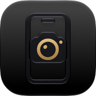
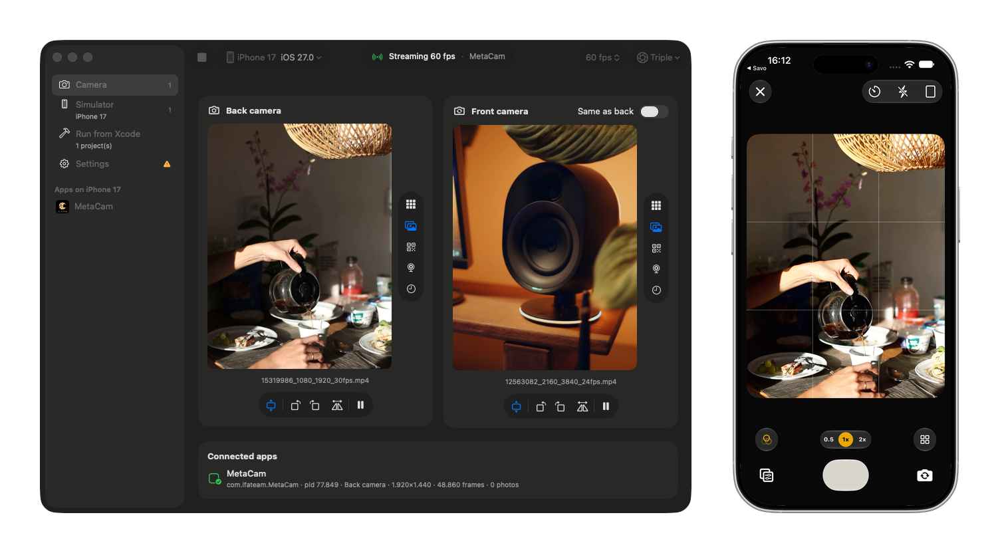
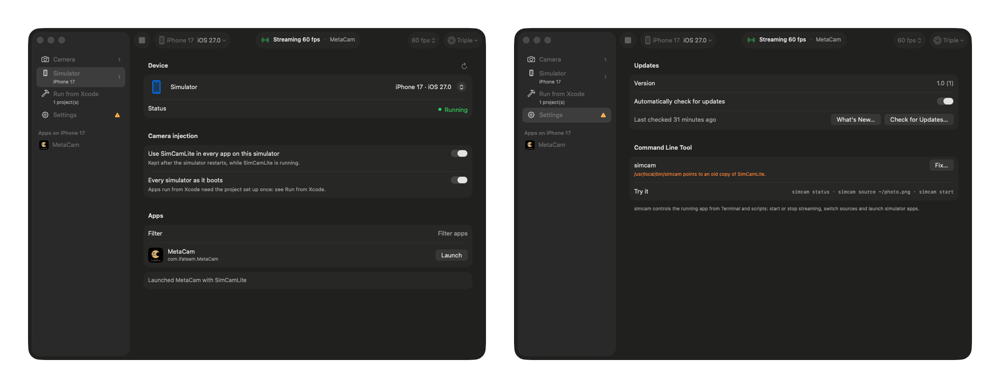

<div align="center">



# SimCam Lite

**A free, open-source camera for the iOS Simulator — with zero changes to your app's code.**

Stream photos, 4K video, QR codes, or your Mac's webcam into any iOS Simulator app (including Xcode's debugger, React Native, and Flutter).

<p>
  <a href="https://github.com/huyhunhngc/simulator-camera/releases/latest"></a>
  
  <a href="LICENSE"></a>
  <a href="https://simcam.ifateam.dev"></a>
</p>

[Download](#install) · [Quick Start](#quick-start) · [CLI & CI](#command-line--automation) · [Docs](https://simcam.ifateam.dev/docs/get-started/installation/) · [Changelog](https://simcam.ifateam.dev/changelog/)

</div>

<!-- Tip: Replace or accompany this screenshot with a 15–20s .mp4 demo clip uploaded via GitHub's markdown editor -->


## Why SimCam Lite?

The iOS Simulator has no camera. If your app captures photos, scans QR codes, or renders a live viewfinder, you normally have to plug in a real iPhone every time you test that code.

SimCam Lite gives the Simulator a working front and back camera out of the box:

- **Zero code changes or SDKs:** No `#if targetEnvironment(simulator)` workarounds or wrapper packages. It emulates `AVFoundation` transparently for SwiftUI, UIKit, Vision, React Native, and Flutter apps.
- **Works with Xcode's Run & Debugger:** Set up a project once (`simcam xcode setup`) and keep pressing `⌘R` with breakpoints and LLDB attached. Committing the shared scheme change is safe — Macs without SimCam Lite ignore the missing dylib.
- **Signed, notarized, no SIP changes:** Signed with an Apple Developer ID, notarized by Apple, and auto-updated via Sparkle. Never disables System Integrity Protection (SIP) or modifies your app binary.
- **100% Free & MIT Licensed:** No per-seat licenses, watermarks, or paid CI add-ons.

## Install

> **Requirements:** macOS 14.0 (Sonoma) or newer, and Xcode with an iOS Simulator runtime (targeting iOS 16.0+ simulator apps).

### Option 1: Homebrew (recommended for App + CLI)

```bash
brew install --cask huyhunhngc/tap/simcam-lite
```

This installs **SimCam Lite** in `/Applications` and puts the `simcam` CLI on your `PATH`. The app updates itself automatically via Sparkle, so you don't need `brew upgrade`.

### Option 2: Direct Download (DMG)

1. Download `SimCamLite-<version>.dmg` from the [latest release](https://github.com/huyhunhngc/simulator-camera/releases/latest).
2. Open the DMG and drag **SimCam Lite** to `/Applications`.
3. Launch SimCam Lite. Future updates install automatically with release notes.

<details>
<summary>Build from source (for contributors)</summary>

Building from source requires **Xcode 26 or newer** and an Apple Developer account.

1. Install [XcodeGen](https://github.com/yonaskolb/XcodeGen):

   ```bash
   brew install xcodegen
   ```

2. Clone the repository:

   ```bash
   git clone https://github.com/huyhunhngc/simulator-camera.git
   ```

3. Copy [`Config/Environment.example.xcconfig`](Config/Environment.example.xcconfig) to `Config/Environment.xcconfig` and set `SIMCAM_DEVELOPMENT_TEAM` to your Apple Developer team ID. You can leave the other values as they are.
4. Build the app:

   ```bash
   cd simulator-camera && scripts/build.sh Debug
   ```

5. Open `build/SimCamLite.app`.

</details>

## Quick Start

1. **Pick a source:** Open SimCam Lite and choose a source for the back camera — **Pattern**, **File…**, **QR…**, or **Mac camera**. Drag and drop any photo or video onto the preview to switch live without restarting your iOS app.
2. **Enable on a simulator:** Go to **Simulator**, pick a booted simulator, and turn on **Use SimCamLite in every app on this simulator**.
3. **Open any app:** Launch your app on the Simulator. Its camera feed now shows your selected source.

### Running from Xcode?

Xcode sets its own `DYLD_INSERT_LIBRARIES` for Main Thread Checker and diagnostics, which overrides simulator-wide injection. Set up each project once:

- In SimCam Lite, open **Run from Xcode** and choose **Set Up Project…** (or drop a `.xcodeproj` / `.xcworkspace` onto it), **or** run:

  ```bash
  simcam xcode setup
  ```

- Stop and Run again in Xcode (`⌘R`). Your debugger, breakpoints, and console work as usual. See [How injection works](docs/injection.md) for details.

## Features

- **Sources & Live Switching:** Stream photos, looping videos (up to **4K / 3840×2160**), generated **QR codes** (with history and one-click *QR Code from Clipboard*), your **Mac's webcam**, or a test pattern. Fit, rotate, mirror, and pause video on any frame.
- **Realistic Camera Emulation:** Independent **back and front cameras** (or mirror back to front), **triple (0.5× · 1× · 3×)**, dual wide, or single camera profiles, **30 or 60 fps**, selectable formats (`1920×1080`, `1920×1440`, `4032×3024`, `3840×2160`), Rec. 709 color tagging, and **Follow Simulator Rotation**.
- **Interactive Simulator Screen:** View and control the selected simulator right beside the camera cards — click to tap, drag to swipe, type with your keyboard, and use Home & Lock buttons without needing screen recording permission.
- **Permission Testing Presets:** Simulate real iOS camera and microphone permission prompts and edge cases (`fresh install`, `camera denied`, `mic denied`, `ask`, `allow`) in one click or via CLI to test your recovery UI.
- **Microphone Audio:** Streams 48 kHz mono 16-bit PCM audio from your Mac microphone into `AVCaptureAudioDataOutput` (including when audio is turned on mid-session, or silence if permission isn't granted).
- **Simulator Manager & Menu Bar App:** Boot simulators, inject per-simulator or automatically on boot, inspect connected apps and live frame/photo counters, and keep streaming from the menu bar.
- **iOS Apps on Mac (Designed for iPad):** Also supports feeding camera frames into device-built iOS apps running on Apple Silicon Macs via [`scripts/mac-inject.sh`](scripts/mac-inject.sh) (see [How injection works](docs/injection.md)).



## Command Line & Automation

Drive everything from Terminal, shell scripts, XCUITest, Maestro, CI pipelines, or AI coding agents using `simcam`:

```bash
# Boot a simulator with camera injection ready, stream a QR code, test a permission edge case, and inspect state
simcam boot "iPhone 17 Pro" --inject --wait
simcam source qr "https://simcam.ifateam.dev"
simcam permission com.example.app mic-denied
simcam launch com.example.app
simcam status --json
```

If you installed via Homebrew, `simcam` is already on your `PATH`. If you installed via DMG, open SimCam Lite and choose **Install Command Line Tool…** (in **Settings › Command Line Tool**, the menu bar icon, or the **SimCam Lite** menu) to link it to `/usr/local/bin/simcam` (or `~/.local/bin`).

| Command | What it does |
| --- | --- |
| `simcam start` / `stop` / `quit` | Start or stop streaming, or quit the app |
| `simcam status` / `status --json` | Show sources, permission mode, and connected apps |
| `simcam source ~/Pictures/receipt.jpg` | Use a photo or video as the back camera |
| `simcam source --front camera` | Use your Mac's camera as the front camera |
| `simcam source qr "https://example.com"` | Show a QR code for a link or text |
| `simcam source pattern` | Show the test pattern |
| `simcam adjust --fit --rotate 90 --mirror` | Change how the source is framed and oriented |
| `simcam pause` / `resume` | Pause or resume a looping video |
| `simcam fps 60` | Stream at 30 or 60 fps |
| `simcam profile triple` | Emulate a `triple`, `dual`, or `single` camera |
| `simcam permission ask` / `allow` | Prompt for camera permission like a real iPhone, or auto-allow |
| `simcam permission <app> <case>` | Apply a TCC permission preset and restart `<app>` |
| `simcam cameras` | List available Mac cameras |
| `simcam devices` | List iOS Simulators |
| `simcam boot "iPhone 17 Pro" --inject` | Boot a simulator with camera injection enabled |
| `simcam apps` | List apps installed on the simulator |
| `simcam launch com.example.app` | Launch an app with the camera turned on |
| `simcam inject on` / `off` | Toggle injection for every app on the simulator |
| `simcam inject auto on` | Automatically enable injection for every simulator as it boots |
| `simcam xcode setup` | Set up the Xcode project in the current folder |

Run `simcam help <command>` for all flags and options, or `simcam --generate-completion-script zsh` for shell completion.

## Compatibility & Limitations

- **Works with:** `AVCaptureVideoPreviewLayer`, `AVCaptureVideoDataOutput`, `AVCapturePhotoOutput`, `AVCaptureAudioDataOutput`, `AVCaptureDeviceRotationCoordinator`, Apple Vision (`VNDetectBarcodesRequest`), and cross-platform camera plugins (such as React Native and Flutter camera packages) that read video or photo frames.
- **Not supported yet:** Movie file recording (`AVCaptureMovieFileOutput`), built-in `AVCaptureMetadataOutput` QR/barcode detection, and multi-camera sessions (`AVCaptureMultiCamSession`).

## How It Works & Documentation

SimCam Lite injects a lightweight `DYLD_INSERT_LIBRARIES` loader (`SimCamLiteLoader.dylib`) that loads `SimCamLiteInject.framework` into Simulator user apps (skipping system processes) and streams frames from the Mac app over shared memory (`/Users/Shared/SimCamLite/frames.shm`) without altering your app binary.

- [Website & Documentation](https://simcam.ifateam.dev)
- [How injection works](docs/injection.md) — simulator injection, single-app launches, Xcode projects, and Designed for iPad apps
- [Development](docs/development.md) — project structure and debugging
- [Releasing](docs/release.md) — signing, notarization, Sparkle appcast, and Homebrew updates
- [Changelog](https://simcam.ifateam.dev/changelog/) — full release history

## Contributing

Bug reports, feature ideas, and pull requests are welcome. Please read [CONTRIBUTING.md](CONTRIBUTING.md) and follow the [Code of Conduct](CODE_OF_CONDUCT.md).

## License

SimCam Lite is open-source software licensed under the [MIT License](LICENSE).
