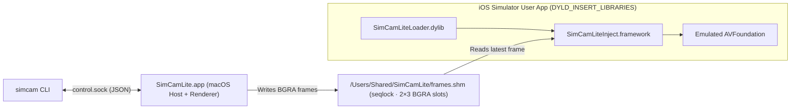

SimCam Lite never modifies your `.app` bundle, binary, or source code. Instead, it injects a lightweight runtime framework into user processes running inside the iOS Simulator.

## Runtime architecture



## 1. Staging the loader & shared memory

On launch, `SimCamLite.app` copies two simulator binaries into `/Users/Shared/SimCamLite/`:

- **`SimCamLiteLoader.dylib`** — a tiny C loader (`Loader/SCLLoader.c`) safe to specify in `DYLD_INSERT_LIBRARIES`. It checks the process and `dlopen`s the framework only inside user apps, skipping Apple system daemons.
- **`SimCamLiteInject.framework`** — Objective-C runtime hooks (`Inject/`) that emulate `AVFoundation` APIs inside the target process.

The host app renders your back and front sources (`FrameRenderer`, `RenderPipeline`) and writes BGRA pixel buffers into `/Users/Shared/SimCamLite/frames.shm` using a lock-free **seqlock** across **2 streams × 3 slots** (up to `1920×1440` or `3840×2160` for 4K back-camera formats).

## 2. Emulated AVFoundation surface

Inside the injected app, `SimCamLiteInject.framework` swizzles and provides fake objects for:

- **`AVCaptureDevice` & `DiscoverySession`**: exposes realistic Front and Back devices matching the selected profile (`triple`, `dual`, or `single`) and formats (including 4K `3840 × 2160`).
- **`AVCaptureSession`**: coordinates inputs, outputs, presets, and active format selection.
- **`AVCaptureVideoDataOutput`**: delivers live `CMSampleBuffer` video frames at 30 or 60 fps (`SCLFramePump`).
- **`AVCapturePhotoOutput`**: captures still photos directly from the current shared-memory frame.
- **`AVCaptureAudioDataOutput`**: streams 48 kHz mono 16-bit PCM audio samples from the Mac microphone (`SCLAudioPump`).
- **`AVCaptureVideoPreviewLayer` & `AVCaptureDeviceRotationCoordinator`**: renders live camera previews and tracks simulator orientation changes.

## 3. Host-disconnected resilience

If you quit `SimCamLite.app` while an injected Simulator app is still open, the app does **not** crash. `SCLFrameReader` detects the stale heartbeat in shared memory and displays a clear `"SimCamLite – Host app is not running"` placeholder frame until the host app starts again.

## 4. CLI control channel

The `simcam` binary lives inside `SimCamLite.app/Contents/MacOS/simcam` and communicates over a Unix domain socket:

```text
~/Library/Application Support/SimCamLite/control.sock
```

Each CLI call sends one JSON `ControlRequest` and receives one `ControlResponse`, keeping GUI controls and Terminal scripts synchronized in real time.
