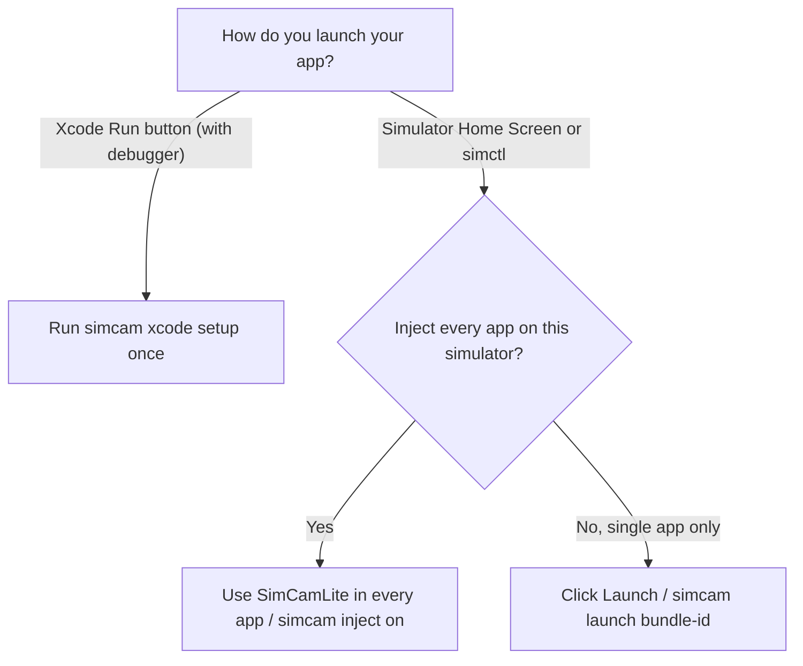

SimCam Lite gives you three ways to attach the virtual camera to iOS Simulator apps. Pick whichever fits how you launch your app.

## Which injection mode should I use?



## 1. Every app on a simulator

In the **Simulator** section, select a device and turn on **Use SimCamLite in every app on this simulator**. Under the hood, this runs:

```bash
xcrun simctl spawn booted launchctl setenv DYLD_INSERT_LIBRARIES /Users/Shared/SimCamLite/SimCamLiteLoader.dylib
```

Every app launched afterwards on that simulator receives the virtual camera. Already-running apps must be relaunched to pick up the change.

Because `launchctl setenv` inside a simulator is cleared when the simulator shuts down, SimCam Lite persists your choice per simulator UDID and automatically restores it every 3 seconds when that simulator boots (while `SimCamLite.app` is running).

<Callout type="note" title="Auto-inject every simulator">
  Enable <strong>Every simulator as it boots</strong> (Simulator tab, menu bar › Simulators › <em>Inject into Every Simulator</em>, or <code>simcam inject auto on</code>) to inject all simulators automatically—even newly created ones.
</Callout>

## 2. Launch a single app

If you only want to inject one specific app without altering the simulator environment, click **Launch** next to the app in the **Apps** list (or use `simcam launch <bundle-id>`). This is equivalent to:

```bash
SIMCTL_CHILD_DYLD_INSERT_LIBRARIES=/Users/Shared/SimCamLite/SimCamLiteLoader.dylib \
  xcrun simctl launch --terminate-running-process booted <bundle-id>
```

## 3. Running from Xcode with the debugger

Xcode’s **Run** button sets its own `DYLD_INSERT_LIBRARIES` (for Main Thread Checker, `libLogRedirect`, and other diagnostics), which overrides simulator-wide `launchctl setenv`.

To make Xcode Run load SimCam Lite while keeping LLDB breakpoints and debugging intact, set up your project once:

<Tabs labels={['GUI Setup', 'CLI Setup']}>
  <TabItem>
    <Steps>
      <ol>
        <li>Open <strong>Run from Xcode</strong> in SimCam Lite (or menu bar › Simulators › <em>Set Up Xcode Project…</em>).</li>
        <li>Click <strong>Set Up Project…</strong> and pick your <code>.xcworkspace</code> or <code>.xcodeproj</code> (or drag and drop it onto the panel).</li>
        <li>Review the detected schemes and toggles, then <strong>Stop and Run</strong> again in Xcode.</li>
      </ol>
    </Steps>
  </TabItem>
  <TabItem>
    <p>Inside your repository root, run:</p>

```bash
simcam xcode setup
```

    <p>Check current status or revert cleanly anytime:</p>

```bash
simcam xcode status
simcam xcode remove
```
  </TabItem>
</Tabs>

### How Xcode scheme setup works

- SimCam Lite inspects each scheme’s target `SDKROOT` and `SUPPORTED_PLATFORMS` and adds `DYLD_INSERT_LIBRARIES = /Users/Shared/SimCamLite/SimCamLiteLoader.dylib` to **Run › Arguments › Environment Variables** for iOS app schemes.
- **macOS and Mac Catalyst schemes are skipped** automatically: macOS `dyld` aborts a host process that loads an iOS Simulator dylib.
- If a scheme already defines `DYLD_INSERT_LIBRARIES`, the loader path is appended with `:`.
- **Safe to commit**: on Macs without SimCam Lite installed, the simulator’s `dyld` ignores the missing library path.

<Callout type="warning" title="Missing or custom schemes">
  If Xcode created an implicit scheme you have never saved, open <strong>Product › Scheme › Manage Schemes…</strong> once and re-run setup. If a scheme’s platform cannot be inferred automatically, pass <code>simcam xcode setup --force</code> or paste the environment variable manually from the panel.
</Callout>
